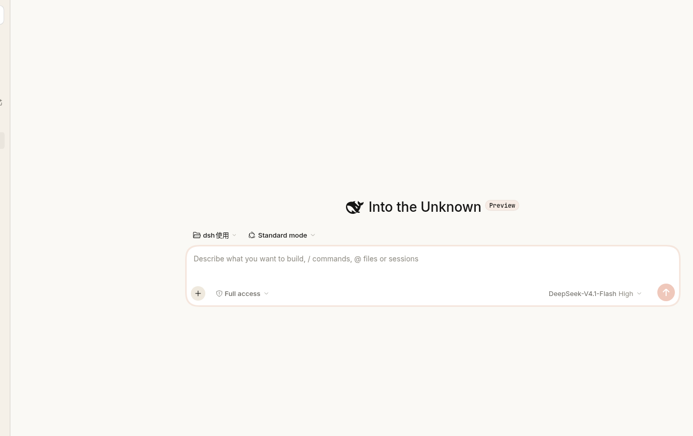

# claude-theme-lite

为 **DeepSeek Harness（DSH）Web GUI** 提供 Claude 配色与字体的 **host-only 主题插件**：
**零客户端 JavaScript**，两个 stylesheet + 四个自托管字体，专为低配机器设计。

> 给跑不动 `dsh-claude-style` 的机器用：同样是 Claude 的暖米色画布、陶土强调色与
> Newsreader 衬线正文，但页面固定开销从 **约 1 MB JS + 1,663 条 CSS 规则** 降到
> **约 42 KB CSS、0 JS**。



> 预览图截自本机、已裁掉侧栏（避免泄露会话名与账号），且是输入卡片圆角还是 28px 时的旧图；当前版本圆角已收窄到 14px。

---

## 为什么会有这个插件

在一台 4 核飞腾 ARM / 8 GB / 老 Radeon 的 Kylin 桌面上，`dsh-claude-style` 让浏览器
单个渲染进程涨到 **5.1 GB / 143% CPU**，切换会话直接卡死；而 DSH 服务端只占
0.4 GB / 0.5%。换成这个插件后同一台机器降到 **0.66–0.84 GB**，滚动流畅。

它的做法很简单：把 Claude 皮肤的 CSS 令牌与元素覆盖直接由**宿主**注入
`index.html`，不产生任何客户端模块——因此没有 MutationObserver、没有常驻定时器、
没有 1 MB 的 JS 解析开销。

## 包含什么

**主题**
- 暖米色画布 `#faf9f5` + 陶土强调色 `#d97757`（claude.ai 应用本身的取色，不是官网营销色）
- 暖黑深色模式 `#181715`，非纯黑
- 正文 Newsreader 衬线、界面 Inter、代码 JetBrains Mono，四个 woff2 自托管、无外部请求
- 全量 `--dsw-*` 令牌覆盖（含宿主新增、原皮肤未覆盖的那些）

**微动效（全部纯 CSS、一次性，无无限循环）**
- 新消息入场：对话流最后三行淡入 + 上移 + 轻微缩放（带 60ms 延迟，等自动滚动到位）
- 用户消息弹出：更强的回弹入场
- 输入卡片：聚焦光晕 + 悬停暖描边
- 发送 / 停止按钮：悬停抬升、按下回缩
- 代码块与终端输出卡片：悬停柔和阴影
- 菜单与下拉浮层：升起 + 缩放入场
- 输入卡片圆角 14px（原宿主为 28px）

**滚动驱动效果（Chromium 115+，不支持时整段自动缺席）**
- 对话栏顶部阅读进度条：2px 陶土色渐变 + 柔光，顶部保留 4% 最小段，只在**可滚动的主对话列表**上出现
- 输入卡片「离开底部」提示环：往上翻历史时描一圈淡淡的陶土色，回到底部消失

**修复**
- 深色模式下 tooltip「亮底白字」：宿主 tooltip 文字固定白色，本主题把深色 `--dsw-alias-tooltip-bg` 定为暖灰 `#43403a`
- 深色模式下 toast 文字对比度（`--dsw-alias-toast-label`）
- `[role="tooltip"]` 兜底规则，固定使用主题令牌

## 安装

### 1. 装到 profile

```bash
# 从 GitHub
dsh plugin --profile web add github:<你的用户名>/dsh-claude-theme-lite

# 或从本地目录
dsh plugin --profile web add file:/path/to/dsh-claude-theme-lite
```

### 2. 在 profile patch 里挂上它

`$DSH_HOME/profiles/<profile>/cordis.patch.yml`：

```yaml
- insert:
    - id: claude-theme-lite
      name: claude-theme-lite
```

### 3. 与 `dsh-claude-style` 二选一

两个主题不要同时启用。继续用本插件时，把原皮肤停掉（配置保留，随时可开回）：

```yaml
- id: ui-skin-claude-style
  disabled: true
```

刷新浏览器页面即可生效（本插件的 CSS 每次请求重读，不必重启宿主）。

## 推荐搭配

| 插件 | 作用 |
|---|---|
| `dsh-chat-perf-css` | 给消息正文挂 `content-visibility: auto`，长会话滚动省渲染（低配机提升明显） |
| `dsh-perf-boost` | 长对话省渲染、后台暂停定时器、大会话预热等纯客户端优化 |

两者都不是本仓库的代码，只是实测搭配效果最好。

## 可调项

都在 `lib/claude-patches.css` 里，改完**同步到安装副本**再刷页面
（`cp lib/claude-patches.css <profile>/node_modules/claude-theme-lite/lib/`）：

| 想改什么 | 位置 |
|---|---|
| 输入卡片圆角 | `html body [data-composer-card] { border-radius: 14px }` |
| 进度条高度 / 最小段 | `cl-read-progress` 关键帧的 `scaleX(0.04)` 与 `.dpb-cv:has(> [data-chat-flow-kind])::before` 的 `height` |
| 消息入场幅度/时长 | `cl-message-in` / `cl-user-in` 关键帧与对应 `animation` 行 |
| 全部动效 | 删掉第 9、10 节；或在系统里打开「减少动画」（`prefers-reduced-motion` 已全量兜底） |

## 兼容性与已知边界

- DSH 0.2.x；主题本身只依赖 `webServer.register` 与 `tapIndex`
- 滚动驱动效果需要 Chromium 115+（360 浏览器/Edge/Chrome 均已支持）；不支持时整段不生效，不会退化成按时间播放的动画
- 阅读进度条只在**列表可滚动**时出现：短会话看不到；点「加载更早」把内容加载到可滚动后才会出现
- 逐行「滚动入场」没有做：宿主在滚动体与消息行之间夹了 `overflow: clip/hidden` 的中间层，`view()` 时间轴会失活，纯 CSS 无法稳定实现
- `:has()` 用于把进度条限制在主对话列表；旧内核会直接跳过该规则

## 许可与致谢

- 本插件代码：MIT，见 [LICENSE](./LICENSE)
- `lib/` 下的 stylesheet 派生自 dsh-market.com 的 `claude` 皮肤（MIT，Copyright (c) 2026 dsh-claude-theme contributors）
- 字体：Newsreader / Inter / JetBrains Mono，SIL Open Font License 1.1
- 完整第三方许可见 [THIRD_PARTY_LICENSES.md](./THIRD_PARTY_LICENSES.md)

---

## English

`claude-theme-lite` is a **host-only** Claude theme for the DeepSeek Harness Web GUI.
It injects two stylesheets and four self-hosted fonts into `index.html` and ships
**zero client-side JavaScript** (~42 KB CSS instead of ~1 MB JS plus 1,663 rules),
so machines that cannot afford the full `dsh-claude-style` skin still get the warm
cream canvas, coral accent, serif reading text and a set of compositor-friendly
micro-animations. Optional scroll-driven extras (reading progress bar, composer
"away from bottom" ring) require Chromium 115+ and silently do nothing elsewhere.

Install with `dsh plugin --profile web add github:<user>/dsh-claude-theme-lite`,
then add the insert row above to your profile patch and disable
`ui-skin-claude-style`. MIT licensed; the stylesheets are derived from the MIT
`claude` skin by dsh-market.com and the bundled fonts are OFL 1.1.
